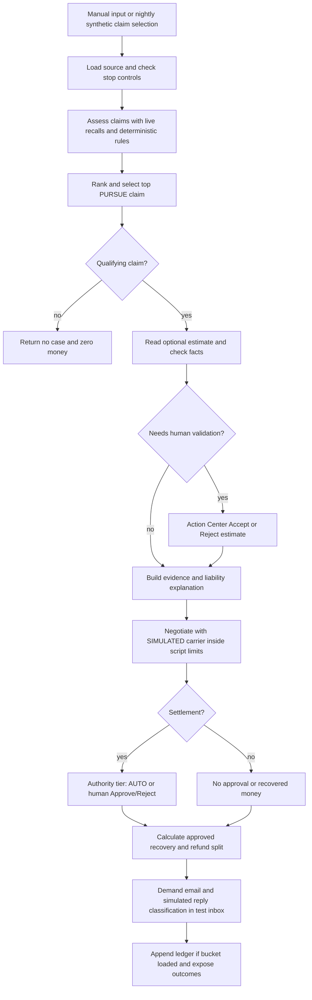
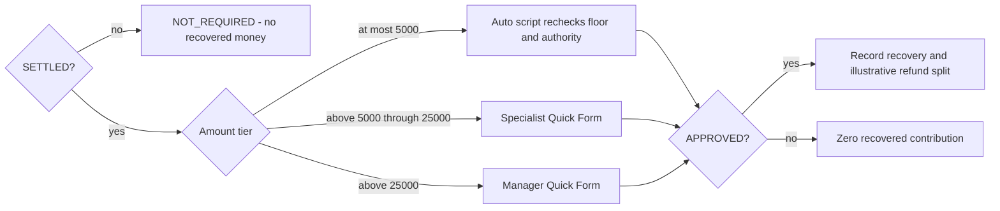

# Process Design Document — Recovery Duel

## Document Control

| Field | Value |
|---|---|
| Author | Pravinraj Vincent |
| Role / byline | UiPath Solutions Engineer |
| Date | 2026-11-06 (ET) |
| Version / status | 1.0 — as-built, completed demonstration |
| Product | Maestro Automate Flow, not BPMN/Orchestrate |
| Repository | https://github.com/PravinrajV/recovery-duel |
| Companion solution design | [recovery-duel-sdd.md](recovery-duel-sdd.md) |
| Documentation method | UiPath planner Phase D conventions, adapted retrospectively; no implementation task derivation |

The build was produced by an unnamed coding agent using the UiPath CLI (`uip`) and UiPath skills: maestro-flow, platform, functions, agents, tasks and human-in-the-loop. These documents use the planner skill. No alternate product name is assigned to the agent.

## Process Objective

Identify missed auto-subrogation opportunities in synthetic closed claims, prioritize a qualifying case, build a grounded explanation, negotiate with a labelled SIMULATED carrier inside deterministic limits, obtain the correct settlement authority and account for the recovery and deductible refund.

This is a finished hackathon demonstration, not a production insurer process or a proposal to rebuild it. It records recovery amounts; it does not transfer funds.

## Problem and Business Context

Closed claim reviews compete with adjusters' time. Finding a recall-related recovery requires connecting claim facts, recall campaigns, fault rules and filing deadlines, then negotiating without losing control of the amounts.

Bisco and Fier's NAIC Journal of Insurance Regulation study (2023) reports salvage plus subrogation of about 4.5% of net claims paid across its whole sample. [SOURCES.md](SOURCES.md) records the source and verification. That statistic is an indicator of business relevance, not a missed-recovery percentage or a target. The demonstration is subrogation-only on a hand-picked synthetic scenario set, not a like-for-like comparison.

No production staffing, claim volumes, legal deadlines or savings assumptions are inferred beyond the recorded demonstration. State-law and deductible-refund logic are illustrative, not legal advice.

## As-Is versus To-Be

“As-is” here describes the motivating manual process, not an audited insurer baseline. “To-be” is the implementation already built.

| Activity | Motivating manual process | Implemented demonstration |
|---|---|---|
| Discover a case | Adjuster reopens files and gathers evidence | Manual or scheduled intake, live recall lookup, scripted screening and ranking |
| Assess liability and value | Human interprets facts, deadlines and authority | Rules own deadlines/fault/recall match/demand/floor; agents explain the supplied facts |
| Validate estimate | Human reads estimate and checks against claim | Optional Document Reader extraction, rule checks, human Accept/Reject when suspect |
| Negotiate | Adjuster exchanges offers and tracks authority | Five-round maximum inline duel against labelled SIMULATED carrier, with script clamps |
| Approve settlement | Specialist/manager considers authority and evidence | AUTO policy, specialist or manager Action Center Quick Form |
| Account and communicate | Record recovery and split deductible share | Ledger/ROI accounting; demand email and simulated replies through a test inbox only |

## Scope

### In Scope

- Synthetic closed claims generated with a fixed seed; claim input or storage-bucket source.
- Manual start and `nightly` timer; deployment triggers currently disabled after successful verification.
- Global and negotiation kill switches; paused-state filtering.
- Live NHTSA recalls API per assessed vehicle; retry then NEEDS_DATA on lookup failure.
- Deterministic screening, ranking and amounts in `rules/rules.js`. The highest-ranked PURSUE claim is negotiated; the run does not negotiate every ranked claim.
- Optional synthetic repair estimate via Document Reader + Analyze Files, `rules/doc_rules.js` and Action Center validation.
- Evidence Analyst, Liability Assessor, Negotiator and SIMULATED carrier agents.
- Settlement authority tiers, ledger, refund split and HTML ROI evidence.
- Real test-inbox demand email and simulated reply classification; prices in replies are not applied.

### Out of Scope

Real customer/employer data, actual carrier integration, money movement, policyholder refund emails, Data Fabric entities, trained Document Understanding/IXP, Slack cards, Context Grounding, separate Demand Letter Writer or Compliance Reviewer agents, webhook/email-received triggers, runtime weather/vPIC/complaints fan-out, arbitration filings and production service levels.

The earlier 2026-11-04 design sketch (kept outside this repository) is aspirational history only. It proposed capabilities that were dropped or deferred; this PDD and the as-built SDD supersede it as descriptions of delivered behavior. [SOURCES.md](SOURCES.md) also maps some proposed nodes rather than confirming implementation.

## Actors and Accountability

| Actor | Human or system | As-built responsibility / boundary |
|---|---|---|
| Pravinraj Vincent | Human owner | Process decisions, scope exclusions, demo narration and submission approval |
| Estimate validator | Human in Action Center | Accept or Reject suspect estimate facts, with optional corrections/note; does not set demand/floor |
| Recovery specialist | Human in Action Center | Approve/Reject settlements above $5,000 through $25,000 |
| Manager | Human in Action Center | Approve/Reject settlements above $25,000 |
| AUTO policy | Script | Recheck floor and authority for settlements at most $5,000; no human task |
| Rules engine | Script | Determine every authoritative dollar and deterministic recovery criterion |
| Document Reader | Inline agent | Extract attached PDF fields with Analyze Files; document content is data, not instructions |
| Evidence Analyst | Inline agent | Evidence memo with supplied recall campaign citations |
| Liability Assessor | Inline agent | Explain liability using the authoritative rules and evidence |
| Negotiator | Inline agent | Propose counters without access to the carrier's private reservation input |
| SIMULATED carrier | Inline agent | Labelled opposing offers/persona; private authority limit, enforced by script |
| `rdstore` | Coded function | Load claims/config and append ledger JSON in Orchestrator bucket |
| `rdmail` | Coded function | SMTP send / IMAP read restricted to recoveryduel@vncntlabs.com |
| Scenario harness | Test utility | Runs synthetic scenarios and completes test Action Center tasks; not an operational human substitute |

Default Quick Form tasks are unassigned in the folder; this document does not invent named reviewers, staffing or escalation recipients.

## Applications and Data Stores

| Application / artifact | Use | Status |
|---|---|---|
| UiPath Maestro Automate Flow | Cloud orchestration, scripts, inline agents, loops and managed HTTP | Real Community execution |
| UiPath Action Center | Estimate validation and settlement approval Quick Forms | Real tasks; test harness supplies decisions during scenarios |
| UiPath Orchestrator | Processes, triggers, credential asset and `recovery-duel-data` bucket | Real; no Data Fabric dependency |
| NHTSA recalls API | Recall campaigns by make/model/year | Live public data; fixture responses cached for offline tests |
| IONOS test inbox | Demand email, SIMULATED replies and correlation | Real SMTP/IMAP via `rdmail`; test inbox only |
| Repo JSON / PDFs | Offline data, generated claims and synthetic repair estimates | Synthetic; estimate pages stamped SYNTHETIC DEMO DOCUMENT |
| Repo HTML ROI view | Summary of recorded scenario results | Offline/report artifact, not a deployed UiPath dashboard |

## Inputs and Outputs

| Kind | Business content | Technical representation / source |
|---|---|---|
| Input claims | Claim ID, state, loss date/cause, paid amount, deductible, fault share, vehicle/VIN, synthetic report and data status | `claims` input or bucket `claims.json`; 200 generated claims in the demonstration |
| Input configuration | Global/negotiation stop flags and paused states | Bucket `config.json`; manual stop inputs also supported |
| Input selection / reference | Assessment date, source, selected bucket claim IDs, run identity | `asOf`, `source`, `claimIds`, `runId` |
| Input simulation | Persona and private reservation | `counterparty`; hidden from Negotiator inputs, not hidden from the entire Flow |
| Optional document | Synthetic repair estimate PDF | `estimateFile` attachment |
| Output assessment | Ranked statuses, recall match, demand/floor and summary | `ranked`, `summary` |
| Output case | Checked document facts/status, evidence citations and liability narrative | `document`, `evidence`, `liability` |
| Output negotiation | Settlement/impasse/review/paused status, rounds, history and approval | `negotiation` |
| Output accounting | Settlement entry, deductible share, insurer net and reconciliation | Bucket ledger when bucket loaded; `roi`, `store` |
| Output email | Sent/matched status, DOC_REQUEST/OFFER/INJECTION_IGNORED/OTHER | `email`; test mailbox messages |

No refund payment or customer notification is emitted. Input-source tests still calculate accounting outputs but do not append the bucket ledger. Failed bucket loads fall back to caller claims, not a second durable store.

## Business Process Diagram

Stop controls can yield no qualifying work, and a negotiation pause or agent error can bypass the duel. Detailed exception routing is in SDD §8. No-case returns bypass the case-email path.

## Step-by-Step Process

1. **Start and select input.** Manual inputs initialize shared request variables. The `nightly` setup selects synthetic CLM-00039 from the bucket with a cooperative simulated carrier. Its configured time is 07:00 UTC (02:00 EST / 03:00 EDT, America/New_York); both deployed timers are disabled after verification job `923fcbe1`.
2. **Load and screen intake.** If source is bucket, `rdstore` reads claims/config and optionally filters claim IDs. On load error the Flow uses trigger input. Intake honors global stop and paused states and normalizes numeric values.
3. **Collect recalls and assess.** For each claim, call live NHTSA recalls with retryCount 2 and a 30-second timeout. Failure marks NEEDS_DATA and continues. Script rules check data availability, illustrative filing deadlines, negligence and recall/component-to-loss match.
4. **Rank and choose one case.** Rule score combines recovery probability, demand and urgency. `pickTop` selects the first PURSUE claim. Without one, return NO_CASE without running agents; a bucket-backed zero-money entry distinguishes KILL_SWITCH when intake was stopped.
5. **Validate optional estimate.** If absent, record DOC_NOT_PROVIDED. If present, Document Reader extracts with Analyze Files. Rules check claim ID, VIN, line-item and total math, amount against claim, confidence and instruction-like text. Failed checks create an Action Center Accept/Reject form. Accept records human validation with check results retained; Reject empties facts. Document errors/rejections do not themselves change money or terminate recovery.
6. **Build the explanation.** Evidence Analyst uses supplied claim, recall assessment and checked document facts. Liability Assessor explains liability and risks without altering deterministic values. No separate letter-writing or compliance agent exists.
7. **Initialize negotiation and honor pause/errors.** A kill-negotiation flag yields PAUSED_KILL_SWITCH. Evidence/liability failure yields NEEDS_REVIEW_AGENT_ERROR. Neither proceeds into the duel.
8. **Conduct the duel.** The SIMULATED carrier acts first each round. A script clamps its offer to its private reservation and current ask and decides acceptance/impasse. While open, Negotiator proposes a counter and a script enforces floor, non-increasing ask and concession rules. Maximum five rounds. The carrier's reservation is not supplied to the Negotiator.
9. **Authorize settlement.** AUTO at most $5,000 rechecks the floor. Above $5,000 through $25,000 requires specialist approval; above $25,000 requires manager approval. Human decisions are Approve/Reject, distinct from estimate Accept/Reject. Non-settlements have NOT_REQUIRED approval. The 24-hour host escalation utility exists but is not scheduled on the tenant.
10. **Book accounting.** `book` computes an illustrative pro-rata deductible refund capped at the deductible and the insurer net. Only SETTLED + APPROVED entries count as recovered money. Rejected amounts can appear as negotiation results but contribute no recovery. No funds are moved.
11. **Exercise test mail.** For a case with a claim ID, a script constructs a labelled demand after accounting calculation. `rdmail` sends to the test inbox, optionally sends a simulated reply, waits 20 seconds and reads matching replies. Claim ID plus run tag prevents stale-message confusion. Injection is flagged/ignored; email cannot change floor or settlement. Classification text is not a newly created document-request task.
12. **Persist and report.** Append the ledger only if bucket load succeeded. Store append deduplicates run_id+claim_id for retry, but is a JSON read/write, not a concurrent transactional ledger. Write failure is non-fatal and exposed in outputs. The repo-side HTML report reconciles recorded scenario outcomes.

## Approval Decision Diagram

## Exceptions and Operational Limitations

| Exception | Implemented response | Qualification |
|---|---|---|
| Global stop / paused state | Stop or filter work before agent execution | Not a production real-time cancellation service |
| NHTSA lookup failure | Retry then NEEDS_DATA and continue | No fabricated evidence; not every HTTP failure was forced on tenant |
| Expired deadline / negligence bar / unrelated recall / missing data | Rules status; no qualifying case if none remain | State rules illustrative only |
| Suspect document | Human validation, with separate document status | Document rejection does not veto the underlying claim or settlement approval |
| Agent failure | Evidence/liability and duel handlers stop negotiation safely for review | Status is not itself a created human-review task; only Evidence Analyst failure was forced in the recorded scratch-copy tenant test |
| Impasse | No approval/recovered money | No arbitration packet or filing built |
| Rejected settlement | Record rejection and zero recovered contribution | No actual financial transaction |
| Bucket outage / ledger error | Input fallback / non-fatal append status | Completion is not proof of durable persistence |
| Mail failure or injected reply | Failed status / classification; keep price unchanged | No live carrier negotiation via inbound email |
| Approval older than 24 hours | Host script can label/reassign when applied | Dry run by default; not installed on a tenant/host schedule |
| Eval service cannot run inline agents | Publish failure evidence and use qualified local scores | Local deterministic evidence-safety check is not the LLM judge |

## Real versus Simulated

| Real capability | Synthetic / illustrative boundary |
|---|---|
| Maestro Flow, five inline agents and Action Center tasks | Claims, policyholders, VINs and opposing carrier are synthetic/simulated |
| NHTSA recalls HTTP integration | Loss narratives and estimate documents are generated, not real evidence |
| Analyze Files document reading, rules and validation forms | Not a trained Document Understanding / IXP model |
| Bucket, coded functions, deployed schedule verification | Timers now disabled; no Data Fabric entities |
| SMTP/IMAP to recoveryduel@vncntlabs.com | Carrier reply messages generated by the Flow and labelled SIMULATED |
| Deterministic refund ledger and reconciliation | Refund entitlement/legal priority illustrative; no payment or refund email |
| NAIC published benchmark | Whole-book salvage plus subrogation, not comparable to chosen test outcomes |

vPIC was publicly verified and fixtures cached during data preparation; it is not an extra runtime Flow integration. The business diagram does not include the earlier sketch's weather/complaints fan-out.

## Success Evidence and Acceptance Record

| Evidence | Recorded result | What it does and does not establish |
|---|---|---|
| [T15_RESULTS.md](runs/T15_RESULTS.md) | 15/15 tenant scenarios | Settlement/impasse/no-case/ranking/tiers/stops; original S13/S14 email portions completed in T16 |
| [A1_RESULTS.md](runs/A1_RESULTS.md) | 7/7 document scenarios | Clean estimates, wrong VIN, tampered total, injection and no-case; demand/floor unchanged |
| [T16_RESULTS.md](runs/T16_RESULTS.md) | Test-mail paths verified | Real mail delivery/matching and simulated replies; no production carrier integration |
| T19 in [BUILD_LOG.md](../BUILD_LOG.md) | Three clean full runs; job `007fde7b` forced agent failure safely | No observed flakes; agent settlement amounts can vary within limits |
| [roi_report.html](roi_report.html) | $72,791 recovered; $2,890 refunds; $69,901 insurer net | Reconciles on a hand-picked synthetic set, not a savings forecast |
| [EVALUATIONS.md](EVALUATIONS.md) | Local 6/6 at 1.0 on real debug outputs | Community eval service failed with 403 on inline agents; service scores do not measure agent quality |
| [SCHEDULE_VERIFY.json](runs/SCHEDULE_VERIFY.json) | Job `923fcbe1`: $1,805, auto approved, mailed and ledger appended | Proves deployed timer route; both triggers subsequently disabled |
| Fresh-clone checks in [BUILD_LOG.md](../BUILD_LOG.md) | Offline unit/build checks passed with CLI + SDK installed | Reproducible source validation, not new tenant testing in this documentation pass |

## Document Status and Remaining Owner Work

PDD and SDD describe a completed implementation. No automation code, rules, tests, traces or tenant configuration are changed by documenting it. No implementation task file is generated.

Remaining owner work is the narrated FaceCam demo and final submission review/video link, then posting after explicit approval. No posting is performed here. The owner has already declined the eligibility email, password rotation and adding a LICENSE; these are not reopened. Data Fabric, trained DU and Slack remain excluded.
