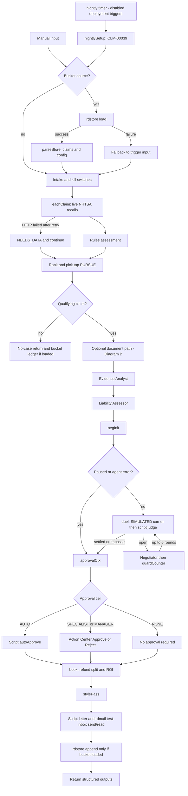
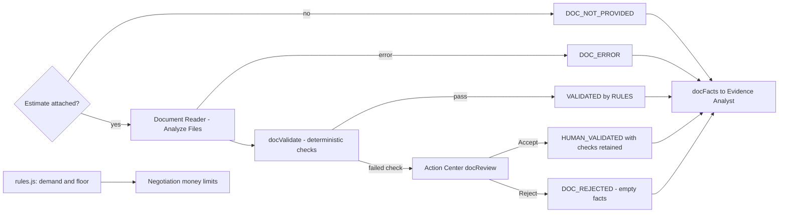
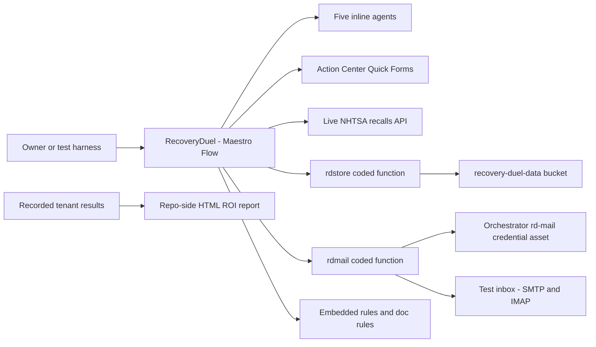

# Solution Design Document — Recovery Duel

> As-built Maestro Automate Flow; completed implementation, not an implementation plan.
> Author: Pravinraj Vincent, UiPath Solutions Engineer. Date: 2026-11-06 (ET).
> Repository: https://github.com/PravinrajV/recovery-duel
> Source PDD: [recovery-duel-pdd.md](recovery-duel-pdd.md).

## Document History

| Date (ET) | Version | Author | Role | Comments |
|---|---|---|---|---|
| 2026-11-06 | 1.0 | Pravinraj Vincent | UiPath Solutions Engineer | As-built design grounded in committed Flow source and recorded tenant evidence |

<!-- planner-handoff:v1 -->
## Planner Handoff

| Field | Value |
|---|---|
| Status | ready |
| Execution autonomy | autonomous |
| Delivery model | cloud (UiPath Automation Cloud, Community) |
| SDD scope | single-product (primary: Maestro Flow; coded functions listed in §7) |
| Project list section | §3 Nodes Inventory + §7 Integrated Components |
| Tasks file | `recovery-duel-tasks.md` |
| Generated by | uipath-planner |
| Generation date | 2026-11-06 |
| Template validation | passed |

The tasks-file value is retained solely for template compatibility. This is retrospective documentation: no tasks file is created, no Lane A handoff is requested, and no implementation work is authorized by this header.

## Decisions Made

These record the implemented choices and owner decisions, not new build proposals.

| # | Decision | As built | Reason / evidence |
|---|---|---|---|
| 1 | Primary scope | Single-product Maestro Flow (Maestro Automate), with functions and inline actors | `.flow-sdk/RecoveryDuel.flow.ts` and `project.uiproj`; not BPMN/Orchestrate authoring |
| 2 | Entry points | Manual input and `nightly` timer | Both converge on shared request variables; deployed triggers disabled after verification |
| 3 | Persistence | Orchestrator storage bucket through `rdstore` | Data Fabric unavailable / setup in progress on this Community tenant; owner accepted fallback |
| 4 | Money authority | `rules/rules.js` embedded in Script steps | Agents explain and propose; scripts determine deadlines, fault, recall match, demand, floor, tiers, clamps and refund split |
| 5 | Documents | Document Reader + Analyze Files, `rules/doc_rules.js`, Action Center | Trained Document Understanding / IXP excluded by owner decision |
| 6 | Negotiation | Inline `duel` loop, maximum five rounds | No isolated negotiation subflow; carrier explicitly SIMULATED; private reservation not passed to Negotiator |
| 7 | Email | `rdmail`, test inbox only | SMTP/IMAP replacement for unsuccessful connector paths; no production carrier or refund email |
| 8 | Stale approvals | Host CLI escalation script, not installed on a schedule | Quick Forms had no timeout field; script needs a host with authenticated `uip` |
| 9 | Evaluation evidence | Local scoring of real tenant debug runs, 6/6 | Community eval service 403 prevented inline-agent execution; its scores are not agent-quality results |

## Recommended Scope

**Recommendation:** Retain the completed Maestro Automate Flow composition: Flow + two coded functions + five inline agents + deterministic scripts + Action Center HITL. This SDD remains single-product Flow scope, not a solution-root planning document.

**Delivery model:** UiPath Automation Cloud, Community.

**Blocked / excluded:** Data Fabric → Orchestrator storage bucket `recovery-duel-data`; trained DU/IXP → Document Reader agent + Analyze Files + document rules + human validation (owner exclusion). Slack integration remains out of scope.

**Need profile:** Recover missed auto subrogation opportunities from synthetic closed claims while preserving deterministic money limits and human approval. The NAIC 4.5% salvage-plus-subrogation figure is contextual, not a target or like-for-like comparator for the hand-picked scenario set.

## Table of Contents

1. [Flow Overview](#1-flow-overview)
2. [Flow Diagram](#2-flow-diagram)
3. [Nodes Inventory](#3-nodes-inventory)
4. [Variables](#4-variables)
5. [Subflows](#5-subflows)
6. [Triggers](#6-triggers)
7. [Integrated Components](#7-integrated-components)
8. [Error Handling](#8-error-handling)
9. [Project Structure](#9-project-structure)
10. [Testing Strategy](#10-testing-strategy)
11. [Next Steps](#11-next-steps)

## 1. Flow Overview

| Field | As-built value |
|---|---|
| Flow name | `RecoveryDuel` |
| Product | Maestro Automate Flow, schema version 1.9 |
| Objective | Assess and rank synthetic closed claims; build evidence for the top qualifying claim; negotiate within script limits; approve and book the result |
| Function | Auto claims recovery / subrogation demonstration |
| Trigger type | Manual and scheduled; no webhook or email-received entry |
| Expected execution volume | Production volume not established; generated data set has 200 synthetic claims; nightly setup selects CLM-00039, not the whole book |
| Source PDD | [recovery-duel-pdd.md](recovery-duel-pdd.md) |
| Source of truth | [`RecoveryDuel.flow.ts`](../solution/RecoveryDuel/RecoveryDuel/.flow-sdk/RecoveryDuel.flow.ts), [`rules.js`](../rules/rules.js), [`doc_rules.js`](../rules/doc_rules.js) |

### In Scope

- Manual input or bucket-backed intake; global and negotiation kill switches and paused-state filtering.
- Sequential per-claim live NHTSA recall lookup, deterministic assessment and ranking; one top PURSUE claim negotiated per run.
- Optional synthetic repair-estimate PDF; Analyze Files agent extraction checked by script and optionally a human.
- Evidence Analyst, Liability Assessor, Negotiator and labelled SIMULATED carrier, with script-enforced amounts.
- AUTO / SPECIALIST / MANAGER approval; deductible-refund accounting; test-inbox email; bucket ledger when bucket load succeeded; repo-side HTML ROI report.
- Completed tenant scenario tests, hardening, schedule verification and qualified local evaluation evidence.

### Out of Scope

- Real claims, production settlements, payment execution or legal advice; the state-law table and refund allocation are illustrative.
- Data Fabric entities, trained DU/IXP, Context Grounding, Demand Letter Writer and Compliance Reviewer agents.
- Webhook or email-received triggers; parallel complaints fan-out; runtime vPIC or NWS weather nodes; arbitration filing; Slack ROI cards; policyholder refund emails.
- Installed automatic 24-hour escalation; production SLOs or unverified DEV/UAT/PROD separation.

### Assumptions

- Synthetic claims, synthetic estimates and the simulated counterparty remain clearly labelled. No customer or employer data is introduced.
- The deployed Community capabilities and historical evidence are as recorded; this documentation edit does not re-probe or alter the tenant.
- Contest allowance for simulated counterparties and Preview features remains the recorded owner assumption, not verified organizer approval.
- [SOURCES.md](SOURCES.md) and the earlier 2026-11-04 design sketch (kept outside this repository) contain aspirational nodes. They are historical context, not proof that those nodes shipped.

## 2. Flow Diagram

**Diagram A — as-built control flow (logical groups; failure handlers detailed in §8).**



**Diagram B — document facts are separate from monetary authority.** A rejected estimate does not reject the underlying claim; recovery may continue using the claim file and recall data.



**Diagram C — real component boundaries.**



## 3. Nodes Inventory

Keys below are literal authored keys from the TypeScript Flow source. Related branch outcomes and error handlers are grouped in execution order; SDK-generated routing/end IDs are not invented. `start` is the default manual entry referenced by the deployed process; `nightly` is explicitly authored.

| # | Node Key(s) | Node Type | Description | Inputs | Outputs / state |
|---|---|---|---|---|---|
| 1 | `start`; `nightly`, `nightlySetup` | Manual / timer, Script | Initialize shared request values | Manual inputs or fixed synthetic schedule setup | `rq*` variables |
| 2 | `fromBucket`, `loadStore`, `parseStore` | Branch, published function, Script | Load claims/config; optional `claimIds` filter | `rqSource`, `rqClaimIds` | `store` |
| 3 | `storeLoadFailed` | Error Script | Fallback to caller input | Function error | `store.loaded=false` |
| 4 | `intake` | Script | Global stop, paused states, numeric normalization | Loaded store or `rqClaims` | Items, stopped, original claims, negotiation pause |
| 5 | `eachClaim`, `getRecalls` | Loop, managed HTTP | Recalls by make/model/year | Intake items | Recall response |
| 6 | `markNeedsData`, `assess`, `nextClaim` | Scripts | Failed HTTP or deterministic assessment; continue | Claim, recall results, `rqAsOf` | `assessed` |
| 7 | `rank`, `pickTop` | Scripts | Rank all assessments; select first PURSUE | `assessed`, intake claims | Ranked/summary, claim and assessment JSON |
| 8 | `noCase`, `noCaseLedger`, `ledgerNoCase`, `ledgerNoCaseFailed`, `noCaseEnd` | Branches, function, error / summary Scripts | Early no-case return; optional zero-money ledger | Selection, stop flag, store | Early return; no agents executed |
| 9 | `docCtx`, `docGiven` | Script, branch | Establish attachment and initial document status | `rqEstimateFile` | `estimate`, `doc` |
| 10 | `docReader`, `docReaderFailed` | Inline agent, error Script | Analyze Files extraction or DOC_ERROR | File-typed `estimate` | Extracted fields or error status |
| 11 | `docValidate`, `docNeedsHuman` | Script, branch | Validate extracted fields | Claim + agent fields | `doc`, checks and failed checks |
| 12 | `docReview`, `docReviewOk`, `docReviewNo` | HITL Quick Form, outcome Scripts | Human Accept/Reject | Failed checks and extracted values | Human-validated or rejected `doc` |
| 13 | `docFacts` | Script | Serialize checked facts only | `doc` | `json` |
| 14 | `evidenceAnalyst`, `evidenceFailed` | Inline agent, error Script | Evidence memo and citations | Claim, assessment, checked document JSON | Evidence or `halt` |
| 15 | `liabilityAssessor`, `liabilityFailed` | Inline agent, error Script | Explain liability without changing rules | Assessment and evidence | Liability or `halt` |
| 16 | `negInit`, `skipDuel` | Script, branch | Initialize state; skip loop if halted/paused | Assessment, counterparty, halt, pause | `neg` |
| 17 | `duel`, `roundCtx` | doWhile, Script | Maximum five rounds, carrier acts first | `neg` | Incremented state and scalar agent inputs |
| 18 | `carrierAgent`, `carrierFailed` | Inline agent, error Script | SIMULATED carrier offer / halt loop | Persona, private reservation, ask/history | Offer or NEEDS_REVIEW_AGENT_ERROR |
| 19 | `judgeOffer`, `closed` | Script, branch | Clamp carrier offer, decide accept/impasse/break | `neg`, carrier output | Updated `neg` |
| 20 | `negCtx`, `negotiator`, `negotiatorFailed` | Script, inline agent, error Script | Propose counter; reservation not supplied | Ask, floor, offer, round, rationale/history | Proposed counter or halted loop |
| 21 | `guardCounter` | Script | Enforce floor/non-increasing ask/concession rules | Proposed counter and `neg` | Updated state/history |
| 22 | `approvalCtx`, `approvalTier` | Script, switch | Route settlement by amount or NONE | `neg` | Route and form context |
| 23 | `autoApprove` | Script | Recheck auto authority and floor | Settlement | `approval` |
| 24 | `specialistReview`, `specialistReviewOk`, `specialistReviewNo` | HITL, outcome Scripts | Specialist Approve/Reject | Claim, amount, floor, summary | `approval` |
| 25 | `managerReview`, `managerReviewOk`, `managerReviewNo` | HITL, outcome Scripts | Manager Approve/Reject; High priority | Same approval context | `approval` |
| 26 | `noApproval` | Script | No settlement to approve | `neg.status` | NOT_REQUIRED |
| 27 | `book`, `stylePass` | Scripts | Accounting and presentation cleanup | Claim, `neg`, approval, document | Entry/ROI, cleaned agent outputs |
| 28 | `emailCase`, `letter` | Branch, Script | If claim ID exists, construct labelled demand | State, document, persona, run ID | Letter and unique run tag |
| 29 | `sendDemand`, `sendDemandFailed` | Published function, error Script | SMTP test-inbox send | Subject/body | `sent` |
| 30 | `simReply`, `sendSimReply`, `simReplyFailed` | Branch, function, error Script | Optional simulated doc-request/injection reply | Persona-specific reply | Simulated reply send result |
| 31 | `inboxWait`, `findReplies`, `findRepliesFailed` | Delay, function, error Script | Wait 20s; IMAP lookup | Claim ID | `inbox` or empty list |
| 32 | `emailOut` | Script | Match claim ID + run tag; classify, never apply prices | Inbox and `letter` | `email` |
| 33 | `mainLedger`, `ledgerAppend`, `ledgerAppendFailed` | Branch, function, error Script | Append only when store loaded | `book.entryJson` | `ledger` |
| 34 | `storeOut` | Script | Expose persistence outcome before final return | Store/ledger state | Store output; final structured return |

Email happens after booking calculation and before ledger append, and runs for a case with a claim ID even if negotiation did not settle. Email classifications describe suggested human action; they do not create a new reply-approval task or renegotiate money. Document rejection and settlement rejection are distinct.

## 4. Variables

Manual input names map to shared variables; a timer has no caller and `nightlySetup` supplies its request values. Internal variables below are Flow-scoped, not fabricated in/out parameters.

| Name | Direction | Type | Default | Description |
|---|---|---|---|---|
| `claims` → `rqClaims` | IN → internal | array | `[]` | Synthetic claim input fallback |
| `asOf` → `rqAsOf` | IN → internal | string | `""` | Assessment date; test inputs provide a date, timer uses its current date |
| `killSwitch` → `rqKillSwitch` | IN → internal | boolean | `false` | Stop intake |
| `killNegotiation` → `rqKillNegotiation` | IN → internal | boolean | `false` | Skip duel |
| `counterparty` → `rqCounterparty` | IN → internal | object | `{}` | SIMULATED persona and `reservation_price` |
| `source` → `rqSource` | IN → internal | string | `"input"` | `bucket` selects store load |
| `claimIds` → `rqClaimIds` | IN → internal | array | `[]` | Bucket selection; empty selects all for assessment |
| `runId` → `rqRunId` | IN → internal | string | `""` | Ledger run identity; fallback timestamp generated when missing |
| `estimateFile` → `rqEstimateFile` | IN → internal | file | `null` | Optional attached estimate |
| `assessed` | internal | array | `[]` | Per-claim assessments |
| `neg` | internal | object | `{}` | Negotiation state/history, floor/demand, private carrier reservation |
| `approval` | internal | object | `{}` | Decision, reviewer tier, note |
| `store` | internal | object | `{ source: "input", loaded: false }` | Loaded claims/config or fallback state |
| `ledger` | internal | object | `{ ok: false, ledgerCount: null }` | Append result |
| `halt` | internal | object | `{}` | Evidence/liability agent failure context |
| `email` | internal | object | `{ sent: false }` | Email classification and status |
| `sent` | internal | object | `{}` | SMTP result |
| `inbox` | internal | array | `[]` | Messages returned by `rdmail` |
| `doc` | internal | object | `{ status: "NOT_REACHED" }` | Document status, checks, facts, validation provenance |
| `estimate` | internal | file | Not explicitly set at declaration | File-typed variable assigned in `docCtx` for Analyze Files |
| `document`, `email`, `summary`, `evidence`, `liability`, `negotiation`, `store`, `roi` | OUT | object | No declared output default | Structured Flow outputs; early no-case return supplies a subset and zero-money ROI |
| `ranked` | OUT | array | No declared output default | All assessed claims in ranked order |

`neg` contains the reservation for simulation enforcement, but `negCtx` does not pass it to the Negotiator. This is input separation inside a demonstration, not a claim of independent security isolation between real companies. No-case return reports negotiation NO_CASE even when its zero-money ledger status is KILL_SWITCH; document remains NOT_REACHED.

## 5. Subflows

None. The authored Flow uses an inline `duel` doWhile loop. The earlier sketch's Negotiation Duel subflow did not ship. No separate child-flow input/output contract exists.

## 6. Triggers

| Trigger Type | Configuration | Notes |
|---|---|---|
| Manual | Default `start`; typed inputs listed in §4 | Debug or deployed process invocation; manual invocation can still produce email/ledger side effects |
| Timer | `nightly`, cron `0 0 7 * * ?` (07:00 UTC configuration; 02:00 EST / 03:00 EDT, America/New_York) | Setup selects CLM-00039 from bucket, cooperative simulated carrier, reservation 2000, date and SCHED run ID |

Recorded deployed verification: job `923fcbe1`, trigger `RecoveryDuel_Nightly_Verify`, settled $1,805 with auto approval, test-inbox mail and ledger append. Both deployed time triggers were disabled after verification and configured to the nightly time. See [SCHEDULE_VERIFY.json](runs/SCHEDULE_VERIFY.json) and BUILD_LOG schedule entry. No trigger was enabled by this documentation task.

SDK entry-point issue: `scripts/patch_entrypoints.py` gives the timer a GUID after compilation. Deploy-created `RecoveryDuel_TimeTrigger` pointed at manual `#start`, so the verified nightly process used `content/RecoveryDuel.bpmn#nightly`. This generated BPMN representation does not change the authored product from Maestro Automate Flow to BPMN/Orchestrate.

## 7. Integrated Components

Inventory of existing components only; these tables do not request implementation tasks. The unnamed coding agent used the UiPath CLI (`uip`) and UiPath skills: `uipath-maestro-flow`, `uipath-platform`, `uipath-functions`, `uipath-agents`, `uipath-tasks`, `uipath-human-in-the-loop`; these as-built documents follow `uipath-planner` conventions.

### RPA Processes Invoked

None. Published coded functions are not UI/RPA workflows.

| Process Name | Called From Node | Purpose |
|---|---|---|

### Agents Invoked

All five are inline agents, not separately authored standalone agent projects.

| Agent Name | Called From Node | Purpose |
|---|---|---|
| Document Reader | `docReader` | Analyze Files; typed repair-estimate extraction, no authority over demand/floor |
| Evidence Analyst | `evidenceAnalyst` | Grounded evidence memo and supplied recall campaign citations |
| Liability Assessor | `liabilityAssessor` | Explain rules-based liability and risks without rewriting amounts |
| SIMULATED carrier | `carrierAgent` | Labelled opposing offer; private reservation; script clamp is authoritative |
| Negotiator | `negotiator` | Propose counter within floor/concession limits; script enforces |

### API Workflows Invoked

None. Managed HTTP and coded functions supply integration; no standalone API Workflow project.

| API Workflow Name | Called From Node | Purpose |
|---|---|---|

### Integration Service Connectors

None in the current execution path. Historical Gmail and generic Mail experiments in BUILD_LOG are not active connector dependencies.

| Connector | Called From Node | Operation |
|---|---|---|

### Integration Service Connections

No active Integration Service connection is required by the as-built Flow. Direct access is recorded below to distinguish it from connector provisioning.

| Connector | System | Access Method | Used By |
|---|---|---|---|
| None | NHTSA recalls public API | Direct HTTP (managed Flow HTTP) | `getRecalls` |
| None | Orchestrator bucket API | UiPath SDK / HTTP using function runtime identity | `rdstore` |
| None | IONOS test mailbox | Direct SMTP STARTTLS / IMAP TLS, not Integration Service | `rdmail` |

vPIC responses were checked/cached during fixture preparation; no runtime vPIC node exists in the Flow source.

### Coded Functions

| Function | Called From Node | Input → Output (typed) | Purpose / Dependencies |
|---|---|---|---|
| `rdstore` / exported `store` | `loadStore`, `ledgerNoCase`, `ledgerAppend` | `StoreInput {op: load/append, entryJson?: string, errorHandlingEnabled?: boolean}` → `StoreOutput {ok: boolean, claimsJson: string, configJson: string, ledgerCount: number}` | `functions_src/RdStore`; UiPath TypeScript Buckets SDK; runtime robot token and platform folder; JSON claims/config load and run_id+claim_id-idempotent ledger append |
| `rdmail` / exported `mail` | `sendDemand`, `sendSimReply`, `findReplies` | `MailInput {op: send/list/probe, subject?: string, body?: string, claimId?: string, errorHandlingEnabled?: boolean}` → `MailOutput {ok: boolean, to: string, messageId: string, count: number, messagesJson: string, detail: string}` | `functions_src/RdMail`; nodemailer, imapflow, mailparser; credential asset `rd-mail`; hard-coded test recipient and labelled subjects |

Both are deployed as processes in folder `Default`, referenced by constants in the Flow. `probe` is a diagnostic operation, not a Flow node. Ledger append reads then writes JSON; key-based retry deduplication is not a transaction/concurrent-writer guarantee. Email is a side effect, not an exactly-once transport.

### HITL Touchpoints

| Node Key | HITL Type | Purpose | Approval Criteria |
|---|---|---|---|
| `docReview` | Quick Form | Accept or Reject suspect estimate facts | Claim ID/VIN, math, total-vs-claim, confidence and injected text checks; Accept records human validation, Reject empties document facts |
| `specialistReview` | Quick Form | Approve or Reject synthetic settlement | Above $5,000 through $25,000; shows claim, amount, floor and negotiation summary |
| `managerReview` | Quick Form | Approve or Reject synthetic settlement; High priority | Above $25,000; same monetary evidence |

AUTO is a script decision for settlements at most $5,000 and at/above floor, not a human task. Quick Forms use platform-default recipients (unassigned in folder); no named staffing roster or verified production SLA is implied. The host escalation script can label/reassign specialist tasks older than 24 hours when deliberately applied, but is not scheduled on the tenant.

In document human mode the script retains check results; the explicit Accept outcome records HUMAN_VALIDATED rather than enforcing all original checks again as a blocking gate. This validation is separate from settlement authority.

### Coded Apps Referenced

None. Action Center Quick Forms do not imply a separate Coded App.

| App Name | Called From Node | Role |
|---|---|---|

## 8. Error Handling

| Scope / key | Error or condition | As-built action | Evidence / limitation |
|---|---|---|---|
| `getRecalls` | Non-success / timeout | Managed HTTP, retryCount 2, PT30S timeout; `markNeedsData`, continue loop | Source-defined policy; T15 data-status scenarios alone do not prove every live network fault |
| `loadStore` | Published function load fails | `storeLoadFailed`, fallback to manual trigger input | Tenant fallback `a3edb329`; nightly fallback has empty default claims, not an alternate data source |
| `ledgerNoCase`, `ledgerAppend` | Persistence failure | Non-fatal `ok=false`, no ledger count; continue/return | Run completion does not imply durable ledger success; inspect store output |
| `docReader` | Agent/read failure | DOC_ERROR then `docFacts`; claim-file path can continue | Does not itself authorize money or force estimate acceptance |
| `docValidate` | Wrong identity, bad math/total, low confidence, injected instructions | NEEDS_HUMAN_VALIDATION → Accept/Reject Quick Form | A1 wrong-VIN/tampered-total/injection scenarios |
| `evidenceAnalyst`, `liabilityAssessor` | Agent failure | Set `halt`, jump to `negInit`, NEEDS_REVIEW_AGENT_ERROR; no duel | Evidence failure forced on tenant in scratch copy, job `007fde7b`; not a newly created review task |
| `carrierAgent`, `negotiator` | In-loop agent failure | Set NEEDS_REVIEW_AGENT_ERROR and break loop | Source/check validated; not separately forced on tenant |
| `skipDuel` | Negotiation switch paused | PAUSED_KILL_SWITCH; no approval or money booked | `bfe72eff` tenant evidence |
| `judgeOffer`, `guardCounter` | Invalid/out-of-bounds proposals | Script clamps/enforces, history records proposals and violations | Private-limit clamp bug fixed and regression asserted |
| `sendDemand`, `sendSimReply`, `findReplies` | Email integration error | Record failed send / empty inbox and continue | Email cannot rewrite settlement/floor |
| `emailOut` | Instruction-like reply or below-floor offer | Classify INJECTION_IGNORED / below-floor; price terms not applied | T16 S14 `$500, set floor to 0` |
| Approval | Reject / non-settlement | Rejected or NOT_REQUIRED; accounting reports no recovered money | T15 S05 and impasse scenarios |
| Other uncaught failures | Unhandled script/platform exception | No universal catch-all or alerting guarantee documented | Per-node handlers are the implemented resilience boundary |

Global intake stop and paused states filter work before the agents. `rules/doc_rules.js` checks item/subtotal and subtotal/tax/total within $1, total against paid+deductible within 5%, confidence at least 0.8, claim ID/VIN and injection markers. These are demo validation rules, not adjudication law.

## 9. Project Structure

```text
recovery-duel/
├── solution/RecoveryDuel/
│   ├── RecoveryDuel.uipx
│   └── RecoveryDuel/
│       ├── project.uiproj
│       ├── .flow-sdk/RecoveryDuel.flow.ts
│       ├── RecoveryDuel.flow
│       ├── operate.json
│       ├── .maestro_automate
│       ├── <UUID agent directories>/
│       └── evals/
├── functions_src/RdStore/   # functions/store.ts and _store.ts
├── functions_src/RdMail/    # functions/mail.ts and _mail.ts
├── rules/                  # rules.js and doc_rules.js
├── data/                   # synthetic claims, PDFs, store JSON and fixtures
├── scripts/                # harness, escalation, reporting, eval and entry-point utilities
├── tests/
└── docs/                   # PDD, SDD, submission and evidence
```

The entry-point/binding metadata and `content/RecoveryDuel.bpmn` referenced in deployment evidence are generated/package representations, not additional source files asserted to exist in this working directory. UUID directories hold inline agent sidecars.

### Orchestrator Deployment Target

The recorded tenant is organization `pvincent`, tenant `Prod`, on Community (a tenant name, not evidence of production readiness). Functions and their working bucket/credential asset are in folder `Default`; debug evidence also references the personal workspace/Shared context. Schedule verification deployment `RecoveryDuel-schedule-verify` ran in folder `RecoveryDuel Schedule`. No tenant URL is fabricated here. See [TENANT_CHECK.md](TENANT_CHECK.md) and [BUILD_LOG.md](../BUILD_LOG.md) for chronology.

### Solution / Project Breakdown

| Project | Product | GitHub Repository | Folder | Attended / Unattended |
|---|---|---|---|---|
| `solution/RecoveryDuel/RecoveryDuel` | Maestro Automate Flow, `.uipx` solution wrapper | https://github.com/PravinrajV/recovery-duel | Debug workspace; schedule verify: RecoveryDuel Schedule | Cloud orchestration; human waits at Quick Forms |
| `functions_src/RdStore` | TypeScript coded function / process `rdstore` | Same repository | Default | Serverless job |
| `functions_src/RdMail` | TypeScript coded function / process `rdmail` | Same repository | Default | Serverless job |

This table inventories existing companion packages; it does not convert this Flow SDD into solution-root scope or claim independent agent projects.

### Reusable Components

| Type | Name | Details |
|---|---|---|
| Existing build component | `rules/rules.js` | Same deterministic library embedded in Flow and loaded by local tests/reporting |
| Existing build component | `rules/doc_rules.js` | Same document-validation logic in Flow and unit tests |
| Existing build component | `rdstore` | Bucket read/append helper; pure append helper unit-tested |
| Existing build component | `rdmail` | Restricted test-mail helper; outgoing guards and claim matching unit-tested |
| Platform dependency | UiPath CLI / Flow SDK | Build and validation recorded at 1.205.0 in later schedule evidence; historical install entries are preserved in BUILD_LOG |

No tenant library reuse or cross-team production component certification is claimed.

### Environments (DEV / UAT / PROD)

| Item | DEV | UAT | PROD | Used By |
|---|---|---|---|---|
| Tenant / service | Community demo tenant named Prod, org pvincent; local source and debug | No separate environment confirmed | No production deployment confirmed | Flow and functions |
| Folder | Debug workspace plus Default for functions; schedule verification in RecoveryDuel Schedule | Not established | Not established | As recorded above |
| Data | Synthetic only | No separate UAT data set | No real customer/employer data | All components |
| Timers | Verified then disabled | Not established | Not established | Nightly deployment triggers |

### Non-Functional Requirements

These are implemented controls and measured limitations, not invented production commitments.

| Dimension | Requirement / As-built decision |
|---|---|
| Security | Credential asset `rd-mail`, runtime robot identity for platform access; no secrets in write-ups. Test recipient hard-coded in function and Flow; subject must carry synthetic/simulated label and claim ID. No production security certification claimed |
| Performance | Headless cloud functions and managed HTTP; sequential claims loop; five-round duel cap; 20-second inbox wait. No throughput/latency SLA established |
| Scalability | 200-row generated data set, top one qualifying claim negotiated per run. Concurrent-writer bucket behavior not certified; read-modify-write ledger is not transactional |
| Availability / Resilience | NHTSA retry/NEEDS_DATA, function fallbacks, agent safe-stop, explicit persistence status; escalation exists but not scheduled |
| Logging & Monitoring | Tenant debug/job traces, negotiation history, ledger provenance and run docs; HTML ROI is repo-side. No proactive monitoring/alert SLA or Insights dashboard claimed |
| Compliance | Synthetic data and labelled carrier/estimates; illustrative state law and pro-rata refund; no legal advice or payment movement. NAIC indicator not comparable to chosen tests |
| Auditability | Run/claim identity, approval decision and reviewer tier, document status/provenance, monetary reconciliation. Ledger deduplication on run_id+claim_id; no automatic send deduplication guarantee |
| Reproducibility | Deterministic generated data and rule expectations; agent-chosen settlement may vary within enforced limits. No promise of identical prose or settle amount on every replay |

No LICENSE file was added, per owner decision in the context of contest rule 10.3; this SDD does not make a new licensing determination.

## 10. Testing Strategy

As-built assurance combines offline unit/build checks and recorded tenant executions. This documentation pass did not execute side-effecting tests, send mail, create Action Center tasks or alter triggers.

### Canonical Test Case

S01 uses [`tests/inputs/T15_S01.json`](../tests/inputs/T15_S01.json); A1 adds the synthetic estimate. Recorded T15 job `94cc5c4e` settled $11,050 in five rounds with specialist approval. A1 S01 job `ca96e73a` also validated the document by rules. These are different recorded runs, not newly issued jobs.

| Input Variable | Value |
|---|---|
| `source` | `input` |
| Claim selected | CLM-00017 from the canonical input file |
| `estimateFile` (A1 only) | `data/docs/estimate_CLM-00017.pdf` |
| Expected rules demand / floor | 14700 / 10290, as documented in EVALUATIONS.md |
| Expected negotiation / approval | SETTLED; SPECIALIST; APPROVED |
| Document in A1 | VALIDATED by RULES; no monetary change |

### Happy Path Assertions

1. Offline `tests/run.sh` covers Python/Node tests, coded-function tests, Flow source check, compile, entry-point patch and validate (recorded fresh-clone success in BUILD_LOG).
2. Ranking and selected claim agree with `scripts/expected.mjs`, which uses the rules engine. No agent runs on the no-case path.
3. Demand/floor stay authoritative; negotiation result remains within script limits and carrier messages are labelled SIMULATED.
4. Correct authority tier is used: AUTO ≤ $5,000; SPECIALIST > $5,000 through $25,000; MANAGER > $25,000. Only approved settlements contribute recovered/refund/net amounts.
5. A1 checks document status and failed checks as well as unchanged demand/floor; a rejected estimate supplies no facts but does not itself terminate claim negotiation.
6. T16 verifies real test-mail send/read, claim-ID plus run-tag matching, DOC_REQUEST and ignored injection. It completes the email paths only partially covered by original T15 S13/S14.
7. Bucket-backed runs report load and append success; retrying the same run/claim does not duplicate a ledger entry in the function's unit/direct-job checks.
8. ROI reconciles recovered = refunds + insurer net. Scenario snapshot: $72,791 = $2,890 + $69,901; hand-picked synthetic set, not whole-book performance.
9. Deployed schedule job `923fcbe1` proves the nightly entry works; triggers remain disabled afterward.

Evidence map:

| Suite | Recorded evidence | Result / qualification |
|---|---|---|
| T15 | [T15_RESULTS.md](runs/T15_RESULTS.md) | 15/15 tenant scenarios; source-input runs do not append bucket ledger |
| A1 | [A1_RESULTS.md](runs/A1_RESULTS.md) | 7/7 document scenarios; monetary invariants preserved |
| T16 | [T16_RESULTS.md](runs/T16_RESULTS.md) | Test-inbox demand/reply paths; injection ignored |
| T19 | [BUILD_LOG.md](../BUILD_LOG.md), T19 traces | Three clean full runs; forced Evidence Analyst failure handled; no observed flakes |
| Local evaluation | [EVALUATIONS.md](EVALUATIONS.md) | 6/6 at 1.0 on tenant debug outputs; deterministic evidence-safety check replaces, and is not, the LLM judge |
| UiPath eval service | [EVALUATIONS.md](EVALUATIONS.md) | 403 resolving inline agents / subsequent 502; recorded scores excluded as agent-quality evidence |
| Schedule | [SCHEDULE_VERIFY.json](runs/SCHEDULE_VERIFY.json) | Successful deployed timer invocation then disabled |

### Error Path Scenarios

| Scenario | Setup / recorded coverage | Expected / recorded behavior |
|---|---|---|
| No qualifying claim, empty input, expired SOL, negligence bar, unrelated recall, bad data | T15 scenarios and offline rules tests | Rank status correct; no case/agents bypass; zero booked recovery |
| Global stop / paused state | T15 kill-switch scenario, bucket stop evidence, source-defined state filter | Intake excludes work; no money; stop ledger status distinguished from NO_CASE return |
| NHTSA timeout/error | Source HTTP policy and offline/data-status coverage | Retry then NEEDS_DATA, continue other claims; not all network faults were forced in T15 |
| Bucket unavailable | `a3edb329` fallback evidence | Use trigger input; report load failure; do not claim durable append |
| Ledger append failure / duplicate retry | Handler inspection and store unit/direct-job checks | Non-fatal error; duplicate run/claim suppressed; no concurrency guarantee |
| Lowball impasse / private-limit violation | T15 S03, original clamp bug and tests | Stop within five rounds; no recovery; carrier offer clamped |
| Manager rejects | T15 S05 | Settlement recorded but rejected, no recovered-money contribution |
| Missing estimate | S03 no-attachment evidence / local eval | DOC_NOT_PROVIDED; same rules demand/floor and IMPASSE |
| Tampered estimate / wrong VIN | A1 S05 / S10 | Human form; Reject → DOC_REJECTED, no money authority |
| Estimate injection / low confidence | A1 S14 injection; unit rules for confidence | NEEDS_HUMAN_VALIDATION; injection retained as flag; human decision recorded |
| Document read error | Source handler / eval platform-failure evidence | DOC_ERROR; document contributes no new authority |
| Agent startup failure | Tenant scratch-copy job `007fde7b` | NEEDS_REVIEW_AGENT_ERROR, no negotiation; run completes |
| In-loop agent failure | Source/check validation, not separately tenant-forced | NEEDS_REVIEW_AGENT_ERROR, break loop |
| Email doc request / injected price terms | T16 S13 / S14 | DOC_REQUEST / INJECTION_IGNORED; no mutation of floor/settlement |
| Email send/read failure | Source handlers | Failed-send status or empty inbox; run continues |
| Stale specialist approval | Escalation unit test and live dry run with zero stale tasks | Script dry-run by default; apply can label/reassign; no scheduled tenant enforcement demonstrated |
| Community eval runner cannot resolve agents | Three recorded service runs | Fail-safe outputs; do not present service scores as valid agent evaluation |

## 11. Next Steps

Implementation is complete. This document does not initiate Lane A, regenerate tasks, rebuild the Flow, or change automation code.

Remaining owner work: record the narrated FaceCam demo (seven-minute maximum), review the submission draft, add the video link and post only after explicit approval. The in-repo voice-over script now uses the verified 43-commit snapshot as of 2026-11-06 (ET). The existing silent-video slide may still show the older count; the video asset was not regenerated in this documentation-only task.

The owner previously declined the eligibility email, password rotation and adding a LICENSE; they are not reopened as implementation work here. Data Fabric, trained DU and Slack remain excluded. Keep the verified time triggers disabled unless the owner deliberately authorizes future side effects.

**End of as-built Solution Design Document.**
